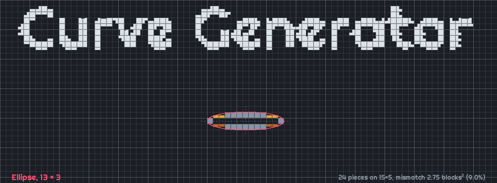

<div align="center">
<h1>Curve Generator</h1>
  

<a href="https://modrinth.com/mod/curvegen"></a>
<a href="https://www.curseforge.com/minecraft/mc-mods/curvegen"></a>
</div>


Building requires JDK 21 or newer.

```
./gradlew build                 # builds both jars and runs the tests
./gradlew :fabric:runClient     # starts a Fabric dev client with the mod
./gradlew :neoforge:runClient   # starts a NeoForge dev client with the mod
```

On Windows, use `gradlew.bat`. The jars end up in `fabric/build/libs/` and `neoforge/build/libs/`. The Minecraft, Fabric and NeoForge versions are in `gradle.properties`.

- The shared code is in `src/`. `fabric/` and `neoforge/` each hold only that loader's entrypoints and metadata.
- `dev.curvegen.core` holds the shape maths, the 2D and 3D solvers and the editor's maths. It has no Minecraft imports, so nearly all the tests run without the game. Keep it that way.
- Run `./gradlew build` before pushing.

Development PRs target `main`. When a version is ready, one release PR promotes a tested commit to `26.3/stable`, using a merge commit. Publishing runs from the stable branch's source. See [the branch and release workflow](AGENTS.md#branch-workflow) for the steps.

---

License: MIT.
