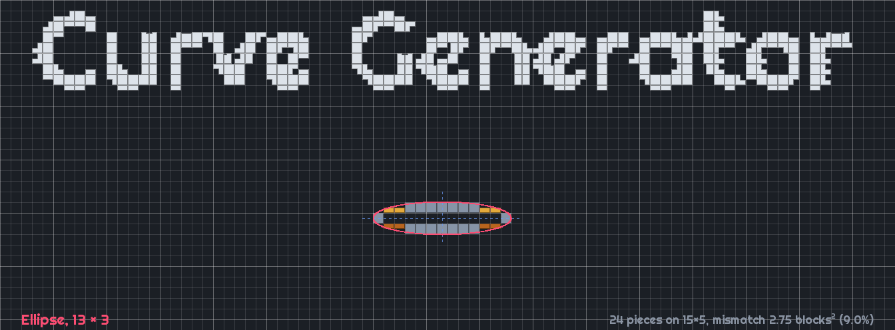
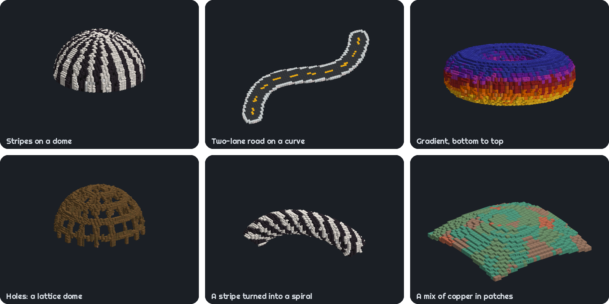
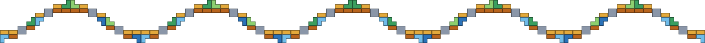

Curve Generator turns 2D and 3D shapes into Minecraft builds. It picks slabs, stairs, walls, fences, panes and other pieces for you, so shapes are smoother and more accurate than those generated with full blocks alone, such as with other tools or mods.

Hold **V** to open the radial menu, or press **G** to open the full menu.

## Features

- **2D shapes**: Build ellipses, equations and Bézier curves.
- **3D shapes**: Build ellipsoids, toruses, 3D equations, Bézier curves and surfaces. Curves can be hollow, as pipes, arches or tunnels.
- **Painting**: Paint a shape with a pattern, a mix of blocks or a gradient. Slabs, stairs and other pieces take each block's material, so a painted shape is as smooth as a plain one.
- **Patterns**: Use the ones that come with the mod, capture one from blocks you've built, or make one from a picture with Chroma Studio. Leave a pattern's empty spots open as holes.
- **Editable hologram**: Resize, move and bend your shape in the world before placing it.
- **Block Types**: Toggle which block types can be used to generate the shape. More block types available can increase accuracy.
- **Colour matching**: Pick a colour and let the mod choose blocks with the closest textures.
- **Block counts**: See how many of each block you'll need.
- **Presets**: Save shapes with their block choices and paint.
- **Litematica export**: Save your shape as a `.litematic` schematic.
- **Server support**: Place builds and undo your last placement even on servers without the mod. You'll need operator rights.
- **Chroma Studio**: Optional. With version 1.2 or newer, paint with the gradients you save in it, mix blocks from its palettes, make patterns from pictures and match colours its way.

## Links

- [The wiki](https://github.com/Neil-001/curvegen/wiki) contains full documentation on how to use the mod.
- Report a bug or suggest a feature in the [issue tracker](https://github.com/Neil-001/curvegen/issues).

